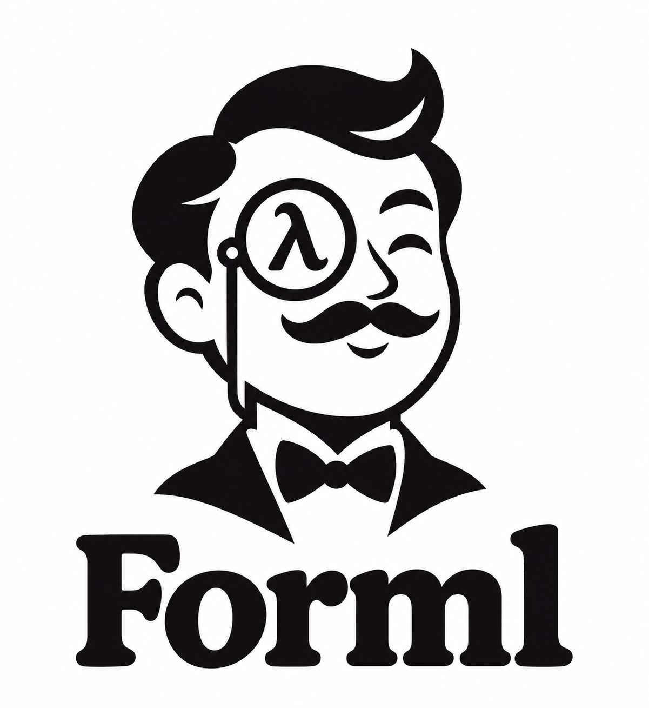

<p align="center">
  
</p>

# forml

`forml` renders Vue 3 forms from JSON. Each step contains questions, and each question type maps to a Vue component. A pure reducer manages answers, validation, and navigation. Effect 4 loads configurations and prepares and sends API requests.

## Run the examples

```sh
npm install
npm run dev
npm run storybook
```

The removals example follows the Property, Details, and Contact steps in the demo and Storybook. Its JSON uses `showWhen` to show property and destination questions for the selected answers. Enter `CF11 9HB` in **Moving from postcode** to look up its district using the free Postcodes.io API. On submit, `send` runs the mock Google and Bing conversions, then saves a receipt locally. [Removals config](demo/removals.json) · [Demo](demo/App.vue) · [Tracking effects](demo/savingEffects.ts) · [Postcodes.io docs](https://postcodes.io/docs/postcode/lookup/)

## Configure a form

```json
{
  "steps": [
    {
      "id": "details",
      "title": "Your details",
      "component": "DetailsStep",
      "questions": [
        { "id": "email", "type": "email", "label": "Email", "required": true },
        {
          "id": "channel",
          "type": "radio",
          "label": "Contact preference",
          "options": [
            { "label": "Email", "value": "email" },
            { "label": "Text message", "value": "sms" }
          ],
          "defaultValue": "email"
        }
      ]
    }
  ]
}
```

Use `FormlType.Text`, `FormlType.Email`, `FormlType.Textarea`, `FormlType.Select`, `FormlType.Autocomplete`, `FormlType.Multiselect`, `FormlType.Radio`, and `FormlType.Checkbox` in TypeScript. `satisfies FormConfig` checks a TypeScript configuration against these choices. `FormConfig<'custom-type'>` also accepts the supplied custom type. JSON uses the enum’s string values. Give every step and question a unique ID within its respective set. Choice values can be strings, numbers, or booleans. Multiselect answers are arrays and default to `[]`. Unanswered questions are omitted unless they have a default. Steps and questions support a `description` and a `props` object for additional data your components need.

### Autocomplete questions

Use `autocomplete` for a searchable list with a single selected value. It uses the same `options` as `select`, and stores the option's value rather than its label. The removals demo uses it for the property-type question.

```json
{
  "id": "city",
  "type": "autocomplete",
  "label": "City",
  "placeholder": "Search cities",
  "required": true,
  "options": [
    { "label": "Cardiff", "value": "cardiff" },
    { "label": "London", "value": "london" },
    { "label": "Manchester", "value": "manchester" }
  ]
}
```

Import `forml/style.css` when using the published package to include the dropdown styles. `AutocompleteQuestion` is also exported for standalone use or custom registration. The existing `forml/progress.css` export remains an alias for the same stylesheet.

Focus the field to see the options, then type to filter their labels without case sensitivity. Click an option, or use the arrow keys and Enter, to select it. Escape and Tab close the list without accepting a highlighted option. Editing a selection clears the previous answer; unselected search text is discarded on blur. The clear button sets the answer to `null`. Only listed values pass validation, including numeric, boolean, and empty-string values. No matches displays an empty-results message. [Interactive stories](.storybook/stories/AutocompleteQuestion.stories.ts)

Custom autocomplete components can share the library's behavior with `useAutocomplete`:

```ts
import { useAutocomplete, type AutocompleteValue, type QuestionComponentEmits, type QuestionComponentProps } from 'forml'

const props = defineProps<QuestionComponentProps>()
const emit = defineEmits<QuestionComponentEmits<AutocompleteValue>>()
const { input, list, open, text, selected, matches, activeIndex, activeId, show, close, search, choose, clear, highlight, keydown } = useAutocomplete(
  props,
  (value) => emit('answer', value),
)
```

Pass the reactive props object directly. Bind the returned refs and handlers in your own markup, as shown in [AutocompleteQuestion](.storybook/demoComponents/AutocompleteQuestion.vue). Filtering, selection, keyboard navigation, clearing, and accessibility IDs live in the library. State transitions and computed values are pure and use no watchers; answer emissions, focus, and scrolling happen only in interaction handlers. External answer or question changes discard obsolete drafts, and changing options cannot leave a removed option highlighted.

### Conditional questions

Set `showWhen` directly on a question. Each key is a question ID and its array lists matching values. Every key must match at least one value. When the source is a multiselect, any selected value in the array matches the rule.

```json
{
  "id": "currentFloor",
  "type": "select",
  "label": "What floor is your flat on?",
  "required": true,
  "options": [
    { "label": "Ground floor", "value": "0" },
    { "label": "First floor", "value": "1" }
  ],
  "showWhen": { "currentType": ["apartment-flat"] }
}
```

Only visible questions are validated and included in submissions. Their earlier answers are restored when the questions become visible again. Rules can refer to questions in other steps. A hidden source question leaves its dependent questions hidden. For headless submissions, pass the schema to `createSubmission` to apply the same rules. Pass all steps when calling `validateAnswers` directly to resolve cross-step rules.

## Manage state

`createFormState(form, initialAnswers?)` returns the initial step, answers, and field errors. `reduceForm(form, state, action)` returns the next state without mutating its arguments or doing I/O. Actions use `FormlActionType.Answer`, `FormlActionType.Back`, `FormlActionType.Next`, and `FormlActionType.Submit`. The submit action validates every step and moves to the first invalid step when needed.

```vue
<script setup lang="ts">
import { Effect } from 'effect'
import { createFormState, decodeForm, defineStepComponents, Forml } from 'forml'
import { shallowRef } from 'vue'

import DetailsStep from './DetailsStep.vue'
import schema from './form.json'

const form = Effect.runSync(decodeForm(schema))
const state = shallowRef(createFormState(form))
const stepComponents = defineStepComponents({ DetailsStep })
</script>

<template>
  <Forml :schema="form" v-model:state="state" :step-components="stepComponents" />
</template>
```

The renderer calls the same reducer and updates `v-model:state` automatically. Omit the model to let the renderer keep state locally. `@action` observes the action and committed next state; it does not need to assign state. Existing controlled forms using `:state` and an `@action` assignment remain supported. Call the reducer directly to apply actions from outside the renderer.

### Run a pipeline before changing steps

Pass `beforeStepChange` to describe work that must succeed before Continue (`Next`) or Back moves to another step. The function receives the navigation action and a detached snapshot of the current state, and returns an Effect. It only builds the pipeline; Forml runs it and updates state after success. Answer changes bypass this hook. Submit uses the separate `submission` pipeline after validation.

```ts
import { Effect } from 'effect'
import { FormlActionType, type FormStepChangeEffect } from 'forml'

import { saveDraft, trackStep } from './effects'

const beforeStepChange: FormStepChangeEffect = (action, state) =>
  Effect.succeed(state).pipe(
    Effect.tap(({ answers }) => saveDraft(answers)),
    Effect.tap(({ stepId }) => trackStep(stepId)),
    Effect.when(Effect.succeed(action.type === FormlActionType.Next)),
  )
```

```vue
<Forml :schema="schema" :before-step-change="beforeStepChange" />
```

Here `saveDraft` and `trackStep` return Effects. `Effect.when` filters the whole pipeline to `Next`; Back continues normally. Omit that filter to run the pipeline in both directions. Use `Effect.void` for an explicit no-op. The pipeline's result is ignored, so there is no state assignment or dispatch callback to return. Add `v-model:state` only when the parent needs access to form state.

Forml disables interaction while the pipeline runs. Failure emits `FormStepChangeError` through `@error` and leaves the current step and state unchanged. Schema replacement, an external state replacement, or unmounting interrupts pending navigation work. Keep I/O inside Effects to keep the pipeline builder pure; `reduceForm` remains a pure state transformation.

Continue validates the current step first. If validation fails, Forml displays field errors without calling `beforeStepChange`. The hook runs only when the destination step differs from the current step, before committing the new state. Submit never calls it, even when submission validation returns to an invalid step. Question `changeEffects` still run after an answer is committed. External state replacements and schema initialization also bypass this hook.

## Show form progress

Pass `FormlProgress` to show a segmented indicator with the step titles and current position. Import its stylesheet when using the published package.

```vue
<script setup lang="ts">
import { Forml, FormlProgress } from 'forml'

import 'forml/progress.css'

import schema from './form.json'
</script>

<template>
  <Forml :schema="schema" :progress-component="FormlProgress" />
</template>
```

Omit `progress-component` to use the default step count. Pass `:progress-component="null"` to hide progress entirely.

For your own Vue component, declare `defineProps<ProgressComponentProps>()`. The component receives the ordered `steps` and zero-based `stepIndex`. Register the import with `defineProgressComponent` and pass it to `Forml`. The removals demo imports its progress component from Storybook. [Custom progress component](.storybook/demoComponents/RemovalsProgress.vue) · [Progress stories](.storybook/stories/RemovalsProgress.stories.ts) · [Demo wiring](demo/App.vue)

```vue
<script setup lang="ts">
import { defineProgressComponent, Forml } from 'forml'

import schema from './form.json'
import MyProgress from './MyProgress.vue'

const progressComponent = defineProgressComponent(MyProgress)
</script>

<template>
  <Forml :schema="schema" :progress-component="progressComponent" />
</template>
```

## Load configurations and A/B variants

Use `decodeForm(value)` for parsed JSON you already have. Pass an Effect that reads from HTTP, storage, or another source to `loadForm`. It validates the result and returns a typed form definition. `FormLoadError` wraps source failures and `FormSchemaError` covers invalid configurations.

```ts
import { Effect } from 'effect'
import { createFormState, loadForm } from 'forml'

function loadRegistration(variant: 'standard' | 'short') {
  return loadForm(
    Effect.tryPromise({
      try: async (signal) => {
        const response = await fetch(`/api/forms/registration?variant=${variant}`, { signal })
        if (!response.ok) throw new Error(`HTTP ${response.status}`)
        return response.json() as Promise<unknown>
      },
      catch: (cause) => cause,
    }),
  ).pipe(Effect.map((form) => ({ form, state: createFormState(form) })))
}
```

Run the loader with your assigned variant and pass its form and state to `Forml`. The frontend registers component names that the variants can reference. Both variants can share a request transform when they use the same answer IDs and values.

## Use components from your Storybook project

Import the Vue component modules from the shared source or component package used by your Storybook. A Storybook story can render the same components on their own or through `Forml`. The library's built-in components are also available as named exports from `forml`.

- **Step components** use `defineProps<StepComponentProps>()` and `defineSlots<StepComponentSlots>()`. They receive `step` and `answers`, and render `<slot />` where the questions should appear. Register them with `defineStepComponents({ DetailsStep })` and set the JSON step’s `component` to that name. The default step layout applies when the JSON omits `component`.
- **Question components** use `defineProps<QuestionComponentProps>()` and `defineEmits<QuestionComponentEmits>()`. They receive `question`, `value`, `inputId`, `describedBy`, and `error`, and emit `answer` with a JSON-compatible value. You can narrow the emitted value with `QuestionComponentEmits<number>`, for example. Register built-in overrides with `defineQuestionComponents({ [FormlType.Radio]: MyRadio })` or register a custom key and use it as the question’s JSON `type`.

The registration helpers check imported Vue components for compatible props and their slot or event contract.

## Add custom question types

Choose any non-empty type name and register its Vue component through `questionComponents`. You do not need to extend `FormlType`. For example, a custom `date` question can be implemented as `DateQuestion.vue`:

```vue
<script setup lang="ts">
import type { QuestionComponentEmits, QuestionComponentProps } from 'forml'

defineProps<QuestionComponentProps>()
const emit = defineEmits<QuestionComponentEmits<string>>()

function update(event: Event) {
  emit('answer', (event.target as HTMLInputElement).value)
}
</script>

<template>
  <label :for="inputId">{{ question.label }}</label>
  <input
    :id="inputId"
    :name="question.id"
    type="date"
    :value="typeof value === 'string' ? value : ''"
    :required="question.required"
    :min="typeof question.props?.min === 'string' ? question.props.min : undefined"
    :aria-describedby="describedBy"
    :aria-invalid="error ? true : undefined"
    @input="update"
  />
</template>
```

Register the component and, optionally, a pure validation function under the same type name:

```ts
import { defineQuestionComponents, type FormConfig, type QuestionValidators } from 'forml'

import DateQuestion from './DateQuestion.vue'

const questionComponents = defineQuestionComponents({ date: DateQuestion })
const questionValidators = {
  date: ({ value, question }) => {
    if (value === '') return
    if (typeof value !== 'string' || !/^\d{4}-\d{2}-\d{2}$/.test(value)) return 'Enter a valid date.'
    const date = new Date(`${value}T00:00:00Z`)
    if (!Number.isFinite(date.getTime()) || date.toISOString().slice(0, 10) !== value) return 'Enter a valid date.'
    const min = question.props?.min
    if (typeof min === 'string' && value < min) return `Choose a date on or after ${min}.`
  },
} satisfies QuestionValidators

const schema = {
  steps: [
    {
      id: 'booking',
      title: 'Booking',
      questions: [
        {
          id: 'date',
          type: 'date',
          label: 'Date',
          required: true,
          props: { min: '2030-01-01' },
        },
      ],
    },
  ],
} as const satisfies FormConfig<'date'>
```

```vue
<Forml :schema="schema" :question-components="questionComponents" :question-validators="questionValidators" />
```

Forml stores emitted answers automatically. Custom answers can be any JSON-compatible value, including objects and arrays; `null` clears an answer. Configuration for the component and validator belongs in `question.props`. Custom type answers are inferred as `JsonValue`, so narrow them in a submission transform when needed.

Validators receive `{ question, value, answers }` and return a field error string or `undefined`. Keep them synchronous and pure; effects belong in `changeEffects` or the submission pipeline. Required checks and built-in validation run first. Custom rules run on Continue for the current step and on Submit for all visible questions. They skip hidden questions and `null`/missing values. Rules can also add checks to built-in types. Back does not validate. Without a custom rule, custom types receive the standard required check.

The same rules work without Vue:

```ts
validateAnswers(schema.steps, answers, questionValidators)
reduceForm(schema, state, action, questionValidators)
createSubmission({ schema, questionValidators, transform: (answers) => answers })
```

Pass the rules to each API you use; a schema-based submission does not inherit the renderer's rules. The demo registers `date` and `tel` in `demo/App.vue` using [RemovalsInput](.storybook/demoComponents/RemovalsInput.vue), with rules in `demo/questionValidators.ts`. The **Custom question types** Storybook example shows custom props, inline errors, and submitted values.

## Run an Effect on answer changes

Give a question an `effectOnChange` name in the form JSON. Register that name on the renderer with `:change-effects="changeEffects"`.

```json
{
  "id": "track",
  "type": "select",
  "label": "Workshop track",
  "options": [{ "label": "Vue fundamentals", "value": "vue" }],
  "effectOnChange": "logTrackSelection"
}
```

```ts
import { Effect } from 'effect'
import type { QuestionChangeEffects } from 'forml'

const changeEffects = {
  logTrackSelection: ({ question, previousValue, value }) => Effect.log('Track selection changed', question.id, previousValue, value),
} satisfies QuestionChangeEffects
```

The renderer dispatches the answer update before running the callback. The callback gets the question, previous value, new value, and a snapshot of the updated answers. A new value or a change that hides the question interrupts its running Effect. Schema changes and unmounting interrupt all active change effects. A failed callback emits `QuestionChangeError` through `@error`, and the answer stays in state. Change effects run independently of form validation and submission.

## Prepare and send an API request

Pass a submission pipeline to `Forml` with `:submission="submission"`. The pure `transform` receives the validated answers and returns the request model synchronously. `send` receives that model and returns an Effect for API calls and follow-up work.

```ts
import { Effect, Schema } from 'effect'
import { createSubmission } from 'forml'

const ContactRequest = Schema.Struct({
  contact_email: Schema.NonEmptyString,
  preferred_channel: Schema.Literals(['email', 'sms']),
})

const submission = createSubmission({
  transform: (answers) =>
    Schema.decodeUnknownSync(ContactRequest)({
      contact_email: typeof answers.email === 'string' ? answers.email.trim() : answers.email,
      preferred_channel: answers.channel,
    }),
  send: (request) =>
    Effect.tryPromise({
      try: async (signal) => {
        const response = await fetch('/api/contacts', {
          method: 'POST',
          headers: { 'Content-Type': 'application/json' },
          body: JSON.stringify(request),
          signal,
        })
        if (!response.ok) throw new Error(`HTTP ${response.status}`)
        return { status: response.status }
      },
      catch: (cause) => cause,
    }),
})
```

When the form definition is available in TypeScript, pass it as `schema` to infer the answer keys and types. Preserve the literal question IDs and option values with `as const satisfies FormConfig`.

```ts
import { createSubmission, FormlType, type FormConfig } from 'forml'

const schema = {
  steps: [
    {
      id: 'contact',
      title: 'Contact details',
      questions: [
        { id: 'email', type: FormlType.Email, label: 'Email', required: true },
        {
          id: 'channel',
          type: FormlType.Radio,
          label: 'Preferred channel',
          required: true,
          options: [
            { label: 'Email', value: 'email' },
            { label: 'Text message', value: 'sms' },
          ],
        },
      ],
    },
  ],
} as const satisfies FormConfig

const submission = createSubmission({
  schema,
  transform: (values) => ({
    contact_email: values.email.trim(),
    preferred_channel: values.channel,
  }),
})
```

Here `values.email` is a `string` and `values.channel` is `'email' | 'sms'`. Use `AnswersFromSchema<typeof schema>` to type a transform declared separately. The submission validates against the supplied schema before calling the transform. A definition loaded from HTTP has the general `FormAnswers` type because its question IDs become known at runtime.

`@submit` receives `{ request, sent: true, response }` after sending succeeds. Omit `send` to receive `{ request, sent: false }`. Omit `submission` to receive the answers as the request.

`@error` receives a tagged error with a message. `FormValidationError` includes the field errors. `RequestTransformError` and `RequestSendError` retain the original cause. `FormRuntimeError` covers unexpected failures from the submission pipeline.

Run `npm run format` to format the project and sort imports with Prettier. Run `npm run format:check` to check formatting without changing files. Imports are grouped as Node built-ins, external packages, and local modules; side-effect imports retain their ordering.

Run `npm test` for the framework tests and `npm run check` for source and type contract checks. Run `npm run build` to produce the minified ESM bundle and stylesheet in `dist/` with Webpack, along with TypeScript declarations.
